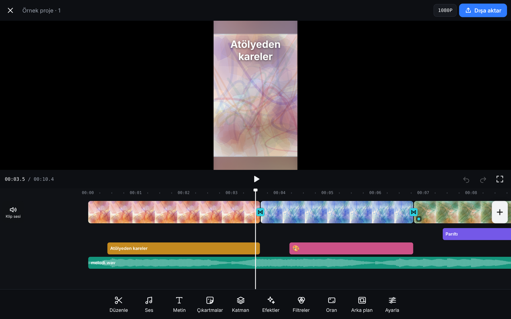

# Makas

**Canlı:** https://erenciracioglu-dotcom.github.io/makas/

## Türkçe
Android telefon ve tablette tarayıcıda çalışan, CapCut düzeninde ücretsiz ve filigransız video düzenleyici. Videolar hiçbir yere yüklenmez; kesme, dışa aktarma ve kayıt tamamen cihazda yapılır.

- Klip bölme, kırpma, uzun basıp sıralama, geri al / yinele
- Hız (0,1x–10x, ses tonu korunur), ses düzeyi, yavaş açılış/kapanış, müzik ve videodan ses
- Metin (12 yazı tipi, hazır stiller, animasyonlar), çıkartmalar, resim/video katmanı
- 16 filtre ve ayarlar, 23 geçiş, 24 efekt, 9:16 / 1:1 / 4:5 / 16:9 oranları, bulanık arka plan
- Taslaklar cihazda otomatik kaydedilir; arayüz Türkçe, Rusça, İngilizce
- MP4 (H.264 + AAC) dışa aktarma, 480p–2K

Telefonda Chrome ile açıp menüden **Ana ekrana ekle** derseniz uygulama gibi tam ekran açılır.

## English
A free, watermark-free, CapCut-style video editor that runs in the browser on Android phones and tablets. Media never leaves the device: decoding, editing and MP4 export (H.264 + AAC) all happen locally via WebCodecs. Includes splitting/trimming, speed with pitch preservation, text, stickers, overlays, 16 filters, 23 transitions, 24 effects, aspect ratios, drafts and a Turkish/Russian/English UI.

`index.html` is a single self-contained file; it can also be downloaded and opened locally in Chrome or Edge.

## Lisans / License
Makas'ın kendi kodu MIT lisanslıdır. Dosyanın içinde paketlenmiş [Mediabunny](https://github.com/Vanilagy/mediabunny) ve `@mediabunny/aac-encoder` (FFmpeg AAC kodlayıcısına dayanır) kendi lisanslarıyla (MPL-2.0 / LGPL) dağıtılır; lisans notları dosyanın sonunda yer alır.

Makas's own code is MIT licensed. The bundled Mediabunny and @mediabunny/aac-encoder (based on FFmpeg's AAC encoder) keep their own licenses (MPL-2.0 / LGPL); their notices are included at the end of the file.
