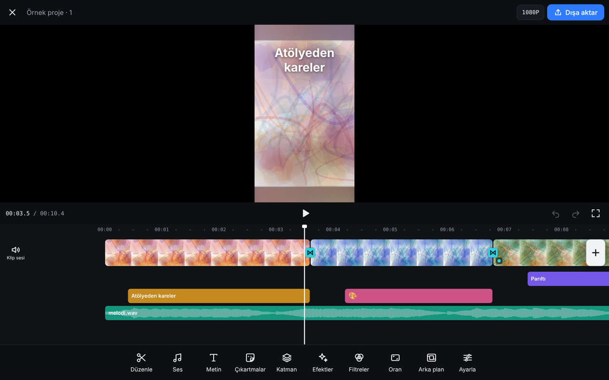

# Makas

**Canlı:** https://erenciracioglu-dotcom.github.io/makas/
**Windows masaüstü sürümü:** [Releases](https://github.com/erenciracioglu-dotcom/makas/releases/latest) sayfasından `Makas-Kurulum-*.exe`

## Türkçe
Android telefon ve tablette tarayıcıda çalışan, CapCut düzeninde ücretsiz ve filigransız video düzenleyici. Videolar hiçbir yere yüklenmez; kesme, dışa aktarma ve kayıt tamamen cihazda yapılır.

- Klip bölme, kırpma, uzun basıp sıralama, geri al / yinele, klibi ters oynatma (sesiyle birlikte)
- Hız (0,1x–10x, ses tonu korunur), ses düzeyi, yavaş açılış/kapanış, müzik ve videodan ses
- Ses kütüphanesi: müzik, ses efekti ve ortam sesleri (yağmur, kuş, kafe…) [Openverse](https://openverse.org) üzerinden Jamendo ve Freesound'dan aranır, dokununca dinlenir, “Ekle” ile doğrudan kaynağından indirilip ses klibi olur. Yalnızca ticari kullanıma izin veren lisanslar (CC0, CC BY, CC BY-SA) gösterilir; dışa aktarınca atıf metni hazır verilir.
- Metin (12 yazı tipi, hazır stiller, animasyonlar), çıkartmalar, resim/video katmanı
- 16 filtre ve ayarlar, 23 geçiş, 24 efekt, 9:16 / 1:1 / 4:5 / 16:9 oranları, bulanık arka plan
- Taslaklar cihazda otomatik kaydedilir; arayüz Türkçe, Rusça, İngilizce
- MP4 dışa aktarma: 480p–4K veya kaynak/özel çözünürlük, kaynak veya özel kare hızı, özel bit hızı, H.264 / H.265 / AV1 / VP9, 2×–3× süper örnekleme, ses kalitesi seçimi
- **Paralel dışa aktarma:** video bölümlere ayrılır ve bölümler aynı anda birkaç kodlayıcıyla kodlanır (bilgisayarda 3, telefonda 2). 90 saniyelik 4K bir video RTX 5080 ile 37 sn yerine 17 sn'de, dahili Intel grafikle 56 sn yerine 39 sn'de çıkıyor. Bir sorun olursa Makas kendiliğinden eski sıralı yoldan dışa aktarır.

Telefonda Chrome ile açıp menüden **Ana ekrana ekle** derseniz uygulama gibi tam ekran açılır.

### Windows masaüstü sürümü
Aynı uygulama, ekran kartını kendisi seçen bir Windows programı olarak da var (`masaustu/` klasörü, Electron). Kurulum yönetici izni istemez ve masaüstüne kısayol açar.
- **Ekran kartı** menüsü: *Otomatik* (NVIDIA kartta 3 GB'tan az boş bellek varsa, örneğin yerel bir yapay zekâ modeli kartı kullanıyorsa, dahili grafiğe geçer), *Yüksek performans*, *Güç tasarrufu*, *Kapalı*. Seçim yalnız Makas için geçerlidir; tarayıcının ayarlarına dokunmaz.
- Dışa aktarılan video "Farklı kaydet" penceresiyle diske kaydedilir.
- Kurulum dosyası imzasız olduğu için Windows ilk açılışta uyarı verebilir: **Ek bilgi → Yine de çalıştır**.

## English
A free, watermark-free, CapCut-style video editor that runs in the browser on Android phones and tablets. Media never leaves the device: decoding, editing and MP4 export (H.264 + AAC) all happen locally via WebCodecs. A built-in sound library searches openly licensed music, sound effects and ambience (Jamendo and Freesound via [Openverse](https://openverse.org)); picks are downloaded straight from the source, limited to licenses that allow commercial use, and the credit text is provided after export. Includes splitting/trimming, reverse playback, speed with pitch preservation, text, stickers, overlays, 16 filters, 23 transitions, 24 effects, aspect ratios, drafts and a Turkish/Russian/English UI. Export settings cover 480p–4K or source/custom resolution, source or custom frame rate, custom bitrate, H.264/H.265/AV1/VP9, 2×–3× supersampling and audio bitrate.

**Parallel export:** the timeline is split into sections that are encoded at the same time by several encoders (3 on desktop, 2 on phones). A 90-second 4K video exports in 17 s instead of 37 s on an RTX 5080 and in 39 s instead of 56 s on integrated Intel graphics. If anything goes wrong, Makas falls back to the original sequential export.

**Windows desktop app:** the same editor packaged with Electron (`masaustu/`), downloadable from [Releases](https://github.com/erenciracioglu-dotcom/makas/releases/latest). It picks the graphics card itself (*Automatic* switches to integrated graphics when the NVIDIA card has less than 3 GB free, e.g. while a local AI model is loaded), saves exports through a normal Save dialog and installs without admin rights. The installer is unsigned, so Windows may show a warning on first run (More info → Run anyway).

`index.html` is a single self-contained file; it can also be downloaded and opened locally in Chrome or Edge. The parallel export is applied to the bundle by `masaustu/yama/uygula.js` from `masaustu/yama/paralel_r0.js`.

## Lisans / License
Makas'ın kendi kodu MIT lisanslıdır. Dosyanın içinde paketlenmiş [Mediabunny](https://github.com/Vanilagy/mediabunny) ve `@mediabunny/aac-encoder` (FFmpeg AAC kodlayıcısına dayanır) kendi lisanslarıyla (MPL-2.0 / LGPL) dağıtılır; lisans notları dosyanın sonunda yer alır. Masaüstü sürümü [Electron](https://www.electronjs.org/) (MIT) kullanır.

Makas's own code is MIT licensed. The bundled Mediabunny and @mediabunny/aac-encoder (based on FFmpeg's AAC encoder) keep their own licenses (MPL-2.0 / LGPL); their notices are included at the end of the file. The desktop app uses [Electron](https://www.electronjs.org/) (MIT).
